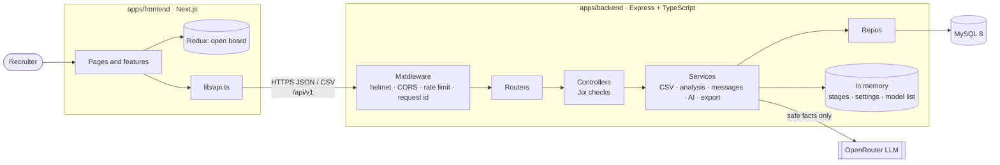
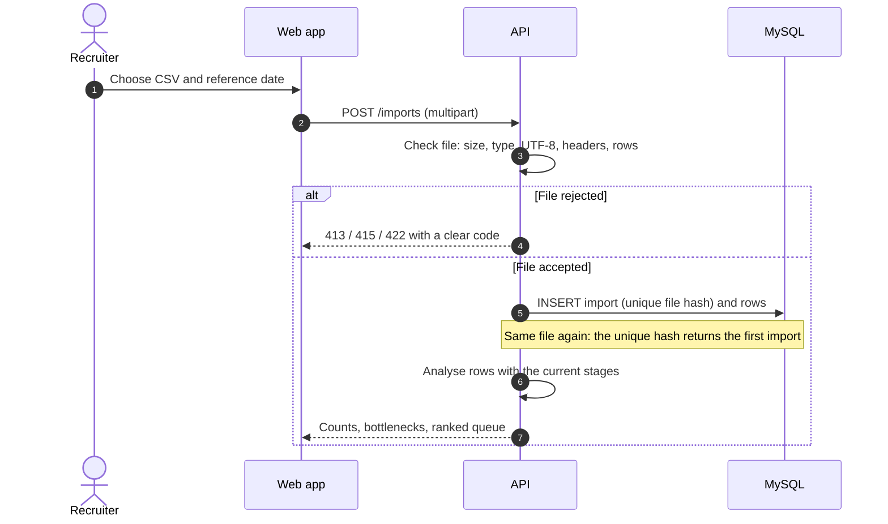
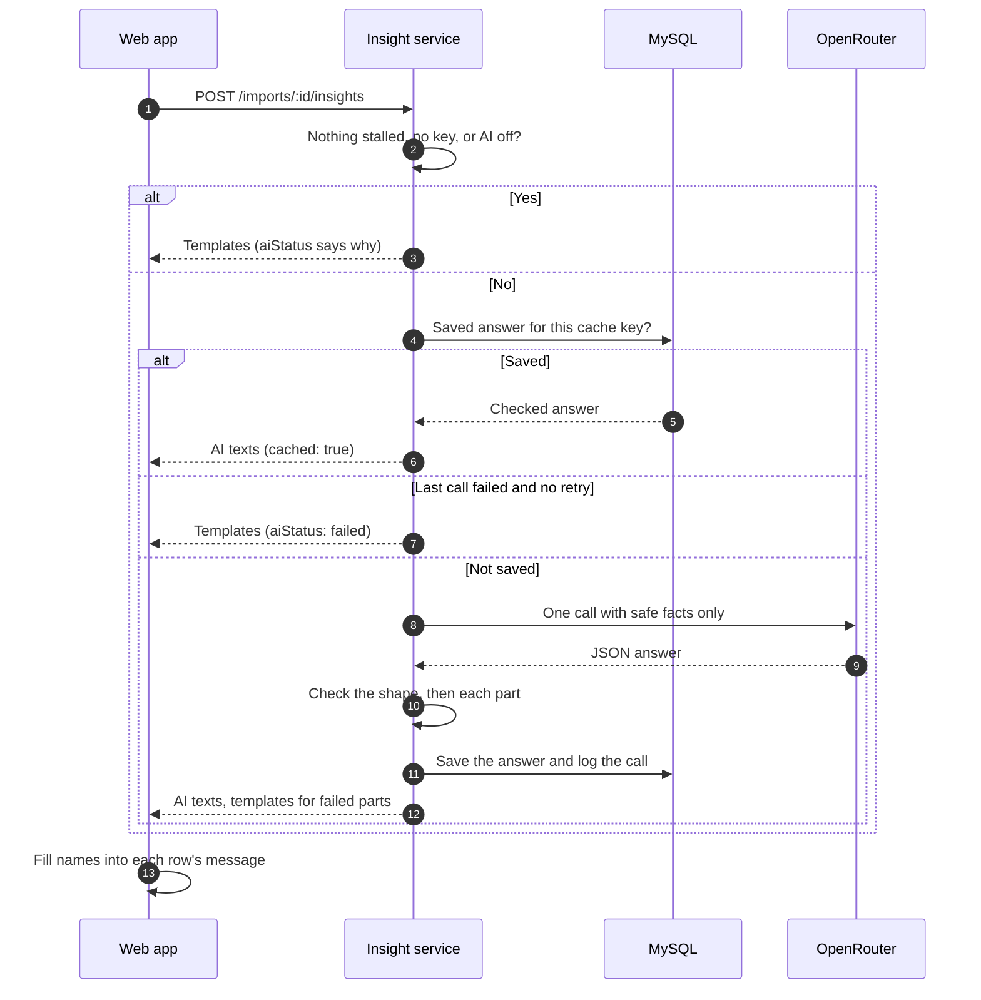

# DESIGN

How StallAlert is built, and why. For running it see the [root README](../README.md); for the tables see the
[ERD](erd.md); for every endpoint see the [API reference](../apps/backend/API.md).

## Overview

A recruiter uploads a hiring-board CSV. StallAlert finds the candidates who have been in a stage longer than that
stage allows, ranks who to follow up first, and gives each one a reason, an action, who the message goes to, and a
ready-to-send message.

The one rule behind the design: **code decides, AI only writes.**

| Code decides (tested, repeatable)                  | AI writes (checked, optional)       |
| -------------------------------------------------- | ----------------------------------- |
| Which rows are valid, and why the others are not   | A short briefing for the top alerts |
| Who is stalled, by how many days                   | One note per bottleneck             |
| The rank, the action and who gets the message      | One message per follow-up action    |
| The template messages, used whenever the AI is not |                                     |

If the AI is off, has no key, is slow, or writes something that fails a check, the app still works: that part uses its
template.

## Architecture

| Part     | Choice                                                                 | Why                                                                    |
| -------- | ---------------------------------------------------------------------- | ---------------------------------------------------------------------- |
| Frontend | Next.js 16 App Router, Redux Toolkit, Tailwind 4, Radix (shadcn style) | Pages per route, small shared state (the open board), accessible parts |
| Backend  | Express, TypeScript, Joi                                               | Router → controller → service → repo → model; each layer has one job   |
| Database | MySQL 8 with Sequelize and migrations                                  | Real constraints (unique hash, cascades); schema history in code       |
| AI       | OpenRouter, JSON output                                                | One API for many models; the model is picked in Settings               |
| Run      | Docker Compose per app, root files include them                        | One command for the whole app; each app can also run alone             |

## Upload and analysis

**How a row becomes an alert**

1. **Check the row**: missing value, unreadable date, future date, unknown stage, duplicate ID or wrong field count. A
   bad row is listed under row errors and skipped.
2. **Find its stage**, by name or alias. A `final` stage (hired, rejected) or a `paused` stage is never stalled.
3. **Count the days** from `stage_entered_at`, or from `last_activity_at` when that is later, up to the reference date.
4. **Stalled** when the days reach the stage threshold. `overdueDays` = days − threshold.
5. **Rank**: most overdue first; then the later stage (closer to a hire); then the candidate ID, so the order is always
   the same.
6. **Action and recipient** come from the stage. The reason and the template message are built from the same facts.
7. **Bottlenecks**: the stage and the recruiter with the most stalled candidates (2 or more).

The queue is **not stored**. It is recalculated on each request from the saved rows and the current stages (about
49 ms for 10,000 rows), so a threshold change shows at once and there is no cache to go stale.

## AI insights

**What the AI gets.** Only ranks, day counts, action codes and keys like `R1`. Never names, candidate IDs, roles,
stage names, dates or CSV text. The answer comes back with placeholders (`{{first_name}}`, `{{name}}`, `{{role}}`,
`{{recruiter}}`) and the names are filled in after the answer is checked.

**One message per action, not per row.** The AI writes one message for each action code in the queue (at most 7).
Every row with that action uses it. So all 500 rows of a big board get an AI message from one small call, and the
cost does not grow with the number of rows.

**Checked part by part.** Each part (the briefing, each bottleneck note, each action message) must pass the same
rules: the right person for the recipient, no digits, dates, weekdays or timing promises, no links, only known
placeholders, and a length limit. A part that fails uses its template; the parts that pass stay. The whole answer is
dropped only when it has the wrong shape, or when no part passes.

**One call per board.** The checked answer is saved under a cache key: a hash of the import, the reference date, the
stages version, `AI_TOP_N`, the prompt version and the model. Opening the board again, or exporting it, uses the saved
answer. Two requests at the same moment share one call.

**A failure is remembered.** After a failed call the board shows templates and **Retry AI**. The AI is asked again
only when the user clicks it (`"retry": true`), so a broken provider is never called in a loop.

**Safe retry inside one call.** A dropped connection, `429` (honouring `Retry-After`, up to 10 s) or `502`/`503`/`504`
is retried with a short backoff, at most 3 tries, all inside `AI_TIMEOUT_MS`. Every call is logged in `llm_calls`
(model, tokens, cost, time, status), never the text.

## Hiring stages and settings

Stages and settings are read on every request, so they are kept **in memory** and loaded once at start-up. A save
goes to the database first, then the memory copy is replaced.

Stages have a `version`. A save must send the version it loaded; if someone saved in between, the answer is `409` and
nothing changes. The new version also changes the AI cache key, so old AI answers are not reused for new rules.

The model list comes from OpenRouter (models with JSON output only) and is kept in memory for 1 day.

## Export

`GET /imports/:id/export` returns the queue as CSV with the same filters as the screen. It **never calls the AI**:
each row uses the saved AI message for its action, or its template, and `ai_note_status` says which. Values that a
spreadsheet could run as a formula get a `'` in front, and the file starts with a UTF-8 BOM for Excel.

## Security and privacy

| Risk                          | What the app does                                                                                        |
| ----------------------------- | -------------------------------------------------------------------------------------------------------- |
| Candidate data sent to the AI | Only safe facts are sent; names are filled in on our side                                                |
| Guessing import IDs           | The API uses random UUIDs; number IDs never leave the server                                             |
| Bad input                     | Joi checks every request; parameterised queries only                                                     |
| Large or harmful files        | 5 MB, 10,000 rows, `.csv`, UTF-8; kept in memory, never written to disk                                  |
| Abuse and AI cost             | Rate limits per IP on uploads and insights; one AI call per board                                        |
| Spreadsheet formulas          | Export values that start like a formula get a `'` in front                                               |
| Leaks in errors and logs      | No stack traces in answers; logs hold request id, path, status and time, never candidate data or AI text |
| The AI key                    | Only on the server, in `.env` or a secret store; Settings only shows whether it is set                   |

## Tradeoffs

| Decision                                | Gain                                             | Cost                                                                        |
| --------------------------------------- | ------------------------------------------------ | --------------------------------------------------------------------------- |
| Recalculate the queue on each request   | Always matches the current stages; simple        | Some work per request (still about 49 ms for 10,000 rows)                   |
| One AI message per action, not per row  | Fixed small cost; fast; works for any board size | Messages are less personal (names, roles and recruiter are still filled in) |
| AI checks by code                       | Catches wrong people, numbers, dates, links      | Cannot prove a message is true; every AI text is labelled for review        |
| Remember a failure, retry only on click | No loops against a broken provider               | The user has to click **Retry AI**                                          |
| Stages, settings and models in memory   | Fast reads, no extra service                     | One API process only; several would need Redis and a lock                   |
| No sign-in                              | Fits a single-team assessment                    | Not ready for real hiring data without login and roles                      |

## Summary

The app's decisions are plain, tested code, so the same board always gives the same queue. The AI adds better wording
on top, in one checked call per board, and it can fail at any point without breaking the queue, the messages or the
export.
