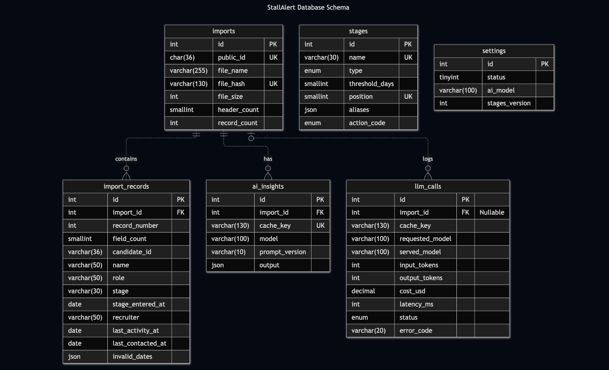
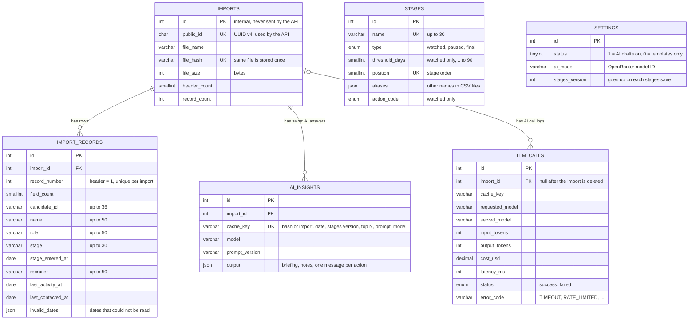

# ERD

The database schema as built by the migrations in `apps/backend/src/infra/migrations`. MySQL 8, `utf8mb4`. Every
table also has `created_at` and `updated_at`.

## Diagram (Mermaid source)

`STAGES` and `SETTINGS` stand alone: they are the configuration every board is checked against, not data of one
import.

## Tables

| Table            | What it stores                                                                                               |
| ---------------- | ------------------------------------------------------------------------------------------------------------ |
| `imports`        | One uploaded CSV file. The unique `file_hash` makes a second upload of the same file return the first import |
| `import_records` | The rows of a file, as read. Wrong dates are kept in `invalid_dates`, so row errors can be shown later       |
| `ai_insights`    | Checked AI answers with placeholders, never names. One per `cache_key`, so a board calls the AI once         |
| `llm_calls`      | One row per AI call: model, tokens, cost, time and status. Never the prompt or the answer text               |
| `stages`         | The hiring stages: type, threshold, order, aliases and the follow-up action                                  |
| `settings`       | One row: AI drafts on or off, the AI model, and the stages version                                           |

## Rules

| Rule                                                       | How                                                                                                                       |
| ---------------------------------------------------------- | ------------------------------------------------------------------------------------------------------------------------- |
| Deleting an import deletes its rows and saved AI answers   | `ON DELETE CASCADE` on `import_records` and `ai_insights`                                                                 |
| AI call logs outlive the import (for cost history)         | `ON DELETE SET NULL` on `llm_calls.import_id`                                                                             |
| The same file is stored once, even for two uploads at once | Unique `file_hash`; the insert decides, never "check then insert"                                                         |
| One row number per import                                  | Unique (`import_id`, `record_number`)                                                                                     |
| Stage names and order are unique                           | Unique `name` and `position`                                                                                              |
| Old saved AI answers are never reused after a change       | `cache_key` is a hash of the import, the reference date, the stages version, `AI_TOP_N`, the prompt version and the model |
| The API never shows the number ID                          | Unique `public_id` (UUID v4); the API looks imports up by it                                                              |

The stalled queue, ranks and messages are **not stored**: they are recalculated from `import_records` and `stages` on
each request (49 ms for 10,000 rows), so a change to a threshold shows at once.
